  

  Estudiante en la Universidad de Eibar. Construyo herramientas que se usan de verdad, 
  automatizo lo aburrido y aplico IA donde aporta. También colaboro en <a href="https://github.com/ts-community"><b>TS Community</b></a>.

 

  
  
  
  

